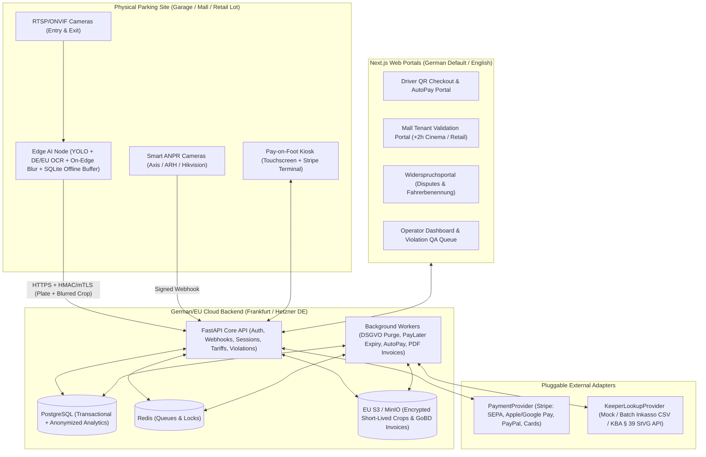
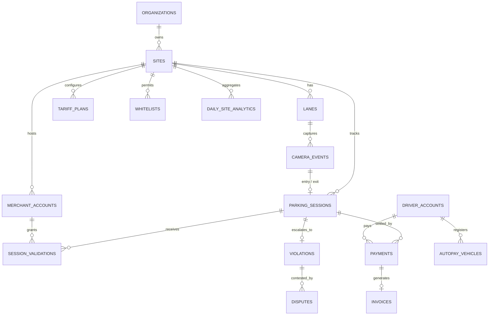

# Architecture Specification — `parkvektor-private-de`

> Private Barrierless ANPR Parking & Ticketing Platform for Germany (Shopping Mall & Retail Park Reference Architecture).
> 100% standalone repository — zero cross-repository dependencies.

---

## 1. High-Level System Architecture



---

## 2. Database Schema & DSGVO Decoupling

To satisfy both **DSGVO Art. 5(1)(e)** (short retention & auto-deletion of compliant plates/photos) and **German Tax Law (`§ 147 AO`)** (8-year invoice voucher retention), ephemeral PII is strictly decoupled from accounting invoices and anonymized operational telemetry.



---

## 3. DSGVO Data Lifecycle & Retention Rules

```mermaid
stateDiagram-v2
    [*] --> EdgeRAM : "Camera captures vehicle pass"
    EdgeRAM --> Discarded : "Noise / non-vehicle (0s storage)"
    EdgeRAM --> ActiveSession : "Blur faces & bystanders in RAM, upload plate + crop"

    ActiveSession --> CleanFreeExit : "Exit within free window / whitelist / validated"
    ActiveSession --> PaidExit : "Paid via AutoPay / Kiosk / QR before exit"
    ActiveSession --> PayLaterWindow : "Exit with balance due (24-48h grace)"

    PayLaterWindow --> PaidExit : "Driver pays online via plate lookup"
    PayLaterWindow --> QAReview : "Grace period expires unpaid"

    CleanFreeExit --> Purged : "Auto-Purge Worker (Immediate to <=24h)"
    PaidExit --> Purged : "Purge plate & S3 crops (<=24-48h); keep invoice only"

    QAReview --> Purged : "Operator rejects (OCR error / invalid) -> Immediate purge"
    QAReview --> ViolationActive : "Operator confirms violation -> KBA § 39 StVG lookup"

    ViolationActive --> CaseClosed : "Paid / Dispute accepted / Settled"
    CaseClosed --> Purged : "Purge evidence & keeper PII after closure window"
    Purged --> [*] : "Write zero-PII record to dsgvo_purge_audit_log"
```



---

## 4. Repository Structure

```text
parkvektor-private-de/
├── backend/         # FastAPI + SQLAlchemy 2.0 + Alembic + DSGVO purge & Stripe adapters
├── edge/            # Standalone Edge AI Node (ONNX/YOLO, DE/EU OCR voter, RAM DSGVO redactor, SQLite WAL)
├── frontend/        # Next.js (TypeScript + Tailwind, DE default / EN toggle)
├── tools/           # German plate image generator & camera webhook/edge simulator
├── infra/           # Dockerfiles + German Art. 13 entrance signage & DPIA (DSFA) templates
└── .github/workflows/
```
