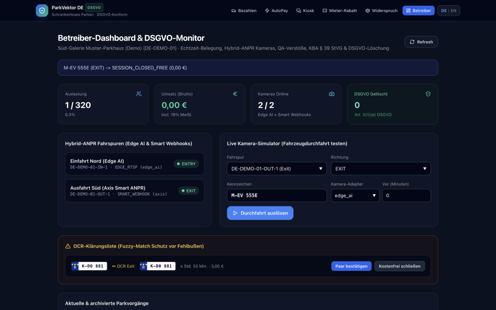
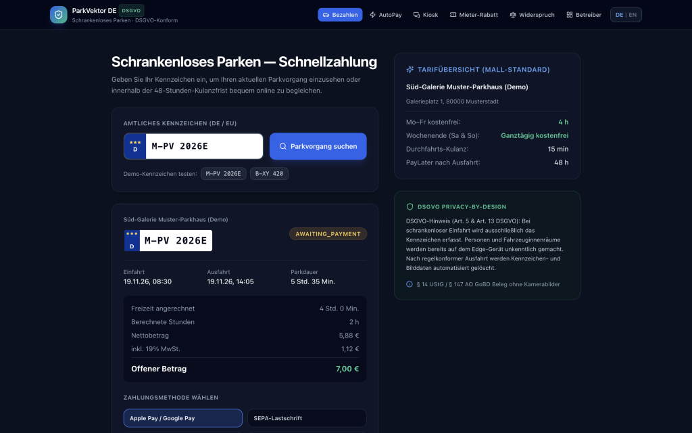
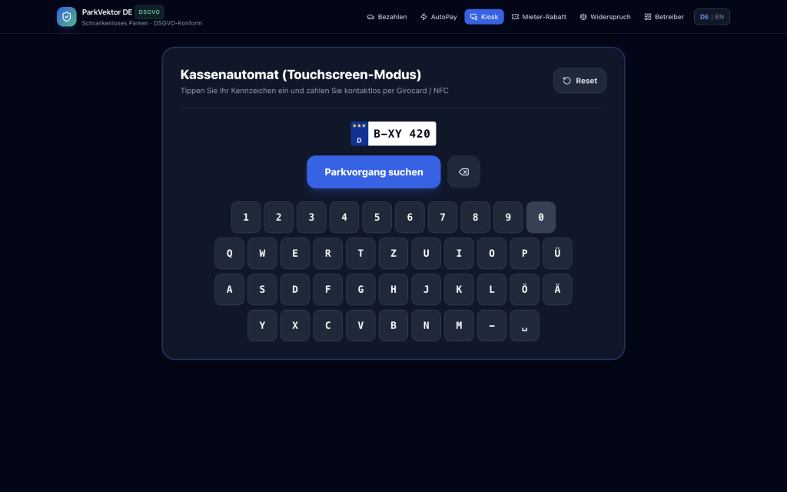
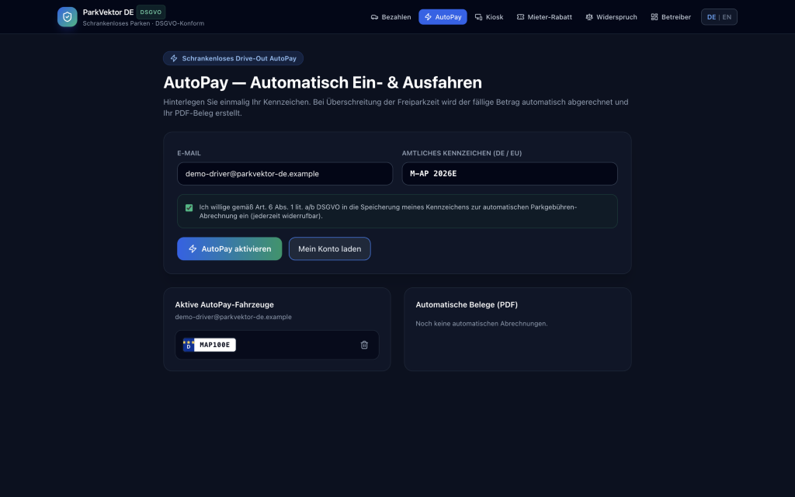

# parkvektor-private-de

**Barrierless ANPR Private Parking & Ticketing Platform for Germany**

[](https://github.com/aymanmali/parkvektor-private-de/actions/workflows/ci.yml)
[](./LICENSE)


`parkvektor-private-de` is a 100% standalone, independent R&D / reference MVP for barrier-free, ticketless private parking management in Germany (malls, retail parks, hotels, hospitals, private garages), designed around **DSGVO Privacy-by-Design** principles and German civil/tax workflows (`BGB Realofferte`, `Art. 5/6/13/35 DSGVO`, `§ 147 AO`, `§ 39 StVG`).

## UI Preview (Bilingual DE / EN Portals)

<table>
  <tr>
    <td width="50%">
      
      <p align="center"><b>Operator Admin &amp; DSGVO Monitor (<code>/de/admin</code>)</b><br/><sub>Live occupancy KPIs, Hybrid ANPR lane heartbeats, camera simulator &amp; OCR fuzzy-match queue</sub></p>
    </td>
    <td width="50%">
      
      <p align="center"><b>Driver QR Checkout (<code>/de/pay</code>)</b><br/><sub>German Euro plate lookup, weekday/weekend tariff breakdown (19% MwSt.) &amp; Stripe/Mock payment</sub></p>
    </td>
  </tr>
  <tr>
    <td width="50%">
      
      <p align="center"><b>Touchscreen Pay-on-Foot Kiosk (<code>/de/kiosk</code>)</b><br/><sub>German QWERTZ on-screen keypad with <code>Ä Ö Ü</code> umlauts for lobby terminals</sub></p>
    </td>
    <td width="50%">
      
      <p align="center"><b>Driver AutoPay Wallet (<code>/de/autopay</code>)</b><br/><sub>Art. 6 DSGVO opt-in plate registration for frictionless drive-out billing &amp; PDF receipts</sub></p>
    </td>
  </tr>
</table>

## Architecture & Highlights

- **Hybrid Plate Capture:**
  - **Mode A (`/edge`):** Standalone Python Edge AI pipeline (RTSP/ONVIF ingest, ONNX/YOLO vehicle/plate detection, multi-frame OCR voting, German `FE-Schrift` & EU plate normalization, **in-RAM DSGVO face/windshield/bystander blurring**, and offline SQLite WAL sync queue).
  - **Mode B (`/backend/app/adapters/cameras`):** Signed webhooks for smart ANPR cameras (**Axis**, **Adaptive Recognition**, **Hikvision**, and **Generic JSON**).
- **Flexible Mall & Retail Tariffs:** Weekday/weekend rules (e.g., 4h free Mon–Fri, free weekends), drive-through grace windows, progressive hourly rates, daily max caps, whitelists (*Dauerparker*), and 24–48h post-exit PayLater window.
- **German Payments & GoBD PDF Invoices:** Pluggable `PaymentProvider` adapter with **Stripe** (SEPA, Apple Pay, Google Pay, PayPal, Cards) + **Mock** mode for instant local dev, generating sequential German PDF invoices (`19% MwSt.`).
- **DSGVO Auto-Purge Engine:** Automatically deletes raw plates and S3 image snapshots for compliant/settled sessions while preserving decoupled `§ 147 AO` tax vouchers and zero-PII `dsgvo_purge_audit_log` proof.
- **Bilingual Web Portals (`/frontend`):** Next.js (TypeScript + Tailwind), **German (`de`) default** with **English (`en`)** toggle.

See [ARCHITECTURE.md](./ARCHITECTURE.md) for the complete technical design, ER diagram, DSGVO retention matrix, and pilot hardware BOM.

## Quickstart (Local Development)

### 1. Backend API (Python 3.12 + `uv`)
```bash
cd backend
uv sync
uv run python -m app.db.seed
uv run uvicorn app.main:app --reload --port 8000
```

### 2. Frontend Portals (Next.js — German default / English toggle)
```bash
cd frontend
npm install
npm run dev
```
Open (German `de` default, or swap `/de` -> `/en`):
- Driver QR Pay Portal: `http://localhost:3000/de/pay`
- Driver AutoPay Wallet: `http://localhost:3000/de/autopay`
- Touchscreen Pay-on-Foot Kiosk: `http://localhost:3000/de/kiosk`
- Mall Tenant Validation Portal (Kino-Welt Demo): `http://localhost:3000/de/validate`
- Driver *Widerspruchsportal* (Disputes & *Fahrerbenennung*): `http://localhost:3000/de/dispute`
- Operator Admin, QA Violations, KBA `§ 39 StVG` & DSGVO Dashboard: `http://localhost:3000/de/admin`

### 3. Simulate Real German Vehicles & Cameras
```bash
cd backend
uv run python ../tools/camera_simulator/simulate.py --scenario mall-demo
```

### 4. Run Tests
```bash
cd backend && uv run pytest
cd ../edge && uv run pytest
cd ../frontend && npm run build
```

### 5. Docker Full Stack (PostgreSQL + Redis + MinIO + Backend + Worker + Frontend + Edge)
```bash
docker compose up --build
```

## Sprint Roadmap

- [x] Architecture blueprint & DSGVO compliance specification
- [x] **Sprint 1:** Core FastAPI backend, PostgreSQL/SQLite schema & Alembic migrations, German `FE-Schrift` & EU plate engine, fuzzy session matcher, Mall-style tariff engine, Stripe & Mock payment adapters, German 19% MwSt. PDF invoice generator, DSGVO auto-purge engine & Art. 15/17 endpoints, standalone Edge AI service (`/edge`), Camera Simulator, Next.js Driver QR Pay & Operator Admin portals (DE/EN), Docker & CI
- [x] **Sprint 2:** Driver AutoPay wallet & frictionless auto-charge on exit, Touchscreen Kiosk mode (German QWERTZ + `Ä Ö Ü`), Mall Tenant Validation portal (`+2h` cinema/retail), Human QA Violation queue, KBA `§ 39 StVG` encrypted lookup / German Notice PDF / Batch CSV export, and Driver *Widerspruchsportal* (*Fahrerbenennung* under BGH *sekundäre Darlegungslast*)

## Legal, Demo Data & License Notice

All seeded operator names, parking garages, cinema tenants, and license plates in this repository are **fictional German demo placeholders** (*Musterdaten*, synthetic simulation only). This project is an independent R&D reference implementation and does **not** constitute legal advice, nor is it affiliated with or endorsed by any third-party camera, hardware, or payment vendors (such as Axis, Adaptive Recognition, Hikvision, or Stripe). Commercial deployment on private parking lots in Germany requires site-specific Art. 13 DSGVO & BGB signage, a formal DPIA (*DSFA*, Art. 35 DSGVO) reviewed by a *Datenschutzbeauftragter*, Art. 28 AVV contracts, and compliance with German RDG / `§ 39 StVG` rules.

Released under the [MIT License](./LICENSE).
